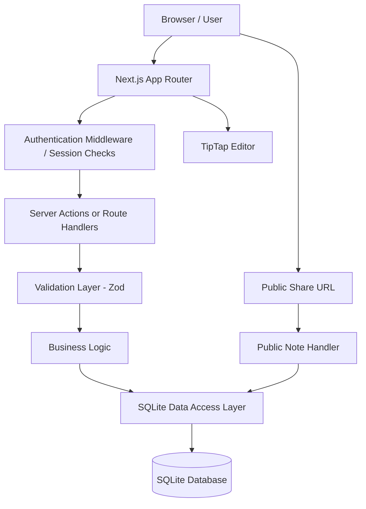
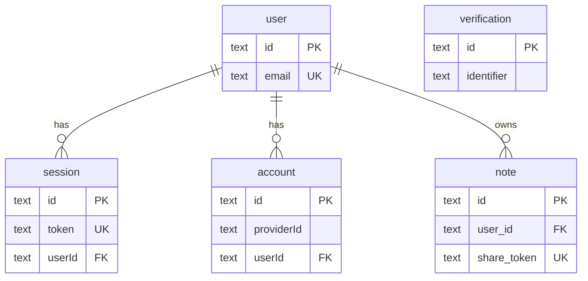

# Technical Specification: Note Taking Web App

*Version 1.0 · Draft for implementation*

This specification is a foundation for implementation, whether you build it by hand or with an AI coding assistant. It keeps the chosen stack (Next.js, Bun, TypeScript, Tailwind CSS, Better Auth, TipTap, and SQLite) and defines practical defaults for features that have not been specified yet.

---

## 1. Project overview

The application is a web-based note-taking platform that allows authenticated users to create, edit, organize, and delete their notes. Users can also publish individual notes through a public URL and revoke public access whenever needed.

The application will provide a lightweight rich-text editing experience with essential formatting options, a secure authentication system, and persistent storage using SQLite.

### Goals

- Provide a simple, responsive interface for managing notes.
- Support rich-text editing and preserve formatting when saving notes.
- Ensure each user can access and manage only their own notes.
- Allow users to share notes publicly without requiring recipients to sign in.
- Keep the architecture straightforward and maintainable.

### Out of scope for version 1

- Collaborative or real-time editing.
- File attachments and image uploads.
- Folders, tags, and advanced note organization.
- Note version history and recovery.
- Comments and public editing.
- Native mobile applications.

---

## 2. Technology stack

| Component | Technology | Purpose |
| --- | --- | --- |
| Web framework | Next.js with App Router | Pages, routing, server rendering, server-side logic |
| Runtime and package manager | Bun | Dependency management and runtime |
| Language | TypeScript | Type safety |
| Styling | Tailwind CSS | Responsive UI |
| Authentication | Better Auth | Sign-up, sign-in, session management; owns the `user`, `session`, `account`, and `verification` tables |
| Rich-text editor | TipTap | Editing and formatting notes |
| Database | SQLite | Persistent application data, shared by Better Auth and the application |
| Database access | Bun SQLite API (`bun:sqlite`) with raw SQL | Application queries and mutations; the same `Database` instance type is passed to Better Auth |
| Validation | Zod | Validate requests and input data |

> **Implementation note:** Use Bun's SQLite API for database operations in the server runtime. Verify compatibility between the chosen Next.js deployment environment and Bun's native SQLite module before deployment. If using a conventional Node.js hosting environment, the database access layer may need an alternative SQLite driver.

---

## 3. Functional requirements

### 3.1 Authentication and user accounts

Users must authenticate before accessing the note-management features.

**Requirements**

- Users can register with a name, an email address, and a password. The name must be 1 to 100 characters (checked server-side in `lib/auth.ts`). Sign-up does not sign the user in (`autoSignIn: false`), and it returns the same response for new and existing emails, so it does not reveal which emails are registered. After registering, the user is sent to sign in. Sign-in and sign-up are rate-limited to 3 requests per 10 seconds per path (`rateLimit` in `lib/auth.ts`). Better Auth requires a `name` for every user, so the sign-up form must collect one.
- Users can sign in and sign out.
- Authentication sessions are managed by Better Auth and stored in the `session` table (see [section 5](#5-database-design)).
- Passwords are hashed by Better Auth and stored on the user's credential `account` row, never in the `user` table.
- Protected pages and server actions must verify the user's session.
- Unauthenticated users attempting to access protected pages are redirected to the sign-in page.
- Users can access only notes they own, unless they are viewing a publicly shared note.

Use Better Auth's supported password authentication and session features. Only email and password are supported. Email verification and password reset are out of scope for this demo app, so the `verification` table is unused.

**Auth page behaviour**

- `/sign-in` serves both modes. `?mode=sign-in` (default) or `?mode=sign-up` selects the mode. Switching modes is a link that changes only the search param.
- `/sign-up` redirects to `/sign-in?mode=sign-up`, keeping any `callbackUrl`.
- After successful sign-in or sign-up, users go to `/dashboard`, or to `callbackUrl` when it is set.
- `callbackUrl` is optional. Only same-origin relative paths (`/...`) are honoured; anything else falls back to `/dashboard`.
- Signed-in users opening `/sign-in` are redirected to the same destination.

### 3.2 Note management

Authenticated users can perform the following operations:

| Operation | Expected behavior |
| --- | --- |
| Create | Create a new note and save its content |
| Read | View notes belonging to the signed-in user |
| Update | Edit and save an existing note |
| Delete | Permanently delete a note |
| List | Display the user's notes, most recently updated first |

Each note must belong to exactly one user.

**Default behavior**

- A new note starts with an empty TipTap document.
- The application automatically saves changes when the user pauses typing.
- The interface displays saving, saved, and error states.
- The application prevents duplicate note creation caused by repeated submissions.
- Deleting a note requires confirmation.
- An empty note can be saved, but the interface should make it easy to recognize and delete.
- If saving fails, the editor retains the unsaved content and offers a retry.

> **Title handling:** A title field is not explicitly required. For version 1, use an optional title field or derive the displayed title from the first line of the note. The implementation should choose one consistent approach.

### 3.3 Rich-text editor

TipTap will provide the editing experience.

**Supported editor features**

| Feature | Description |
| --- | --- |
| Bold and italic | Emphasize selected text. |
| Headings and normal text | Three heading levels (H1, H2, H3), plus paragraphs. |
| Inline code and code blocks | Display code within text or in a separate block. |
| Bullet lists | Create and edit unordered lists. |
| Horizontal separators | Separate sections visually. |

**Editor implementation requirements**

- Store editor content in TipTap's JSON document format.
- Use supported TipTap extensions for every enabled formatting feature.
- Provide a toolbar with controls for formatting, headings, lists, code, and separators.
- Ensure toolbar actions work with the current selection.
- Preserve formatting when a note is reopened.
- Render public notes as read-only content.
- Validate the document structure and limit accepted extensions to those supported by the application.

For code blocks, use an appropriate TipTap code-block extension. Syntax highlighting can be added if desired, but it is not a mandatory requirement for version 1.

### 3.4 Public note sharing

A user can make an individual note publicly accessible and later revoke access.

**Sharing workflow**

1. The owner opens a note.
2. The owner selects **Share publicly**.
3. The application generates a unique, unguessable public URL.
4. The owner copies the URL and shares it.
5. Anyone with the URL can view the note without signing in.
6. The owner selects **Stop sharing** to revoke access.

**Security requirements**

- Public sharing must be disabled by default.
- Public URLs must use cryptographically secure random tokens.
- Public tokens must not expose internal database IDs or user IDs.
- Revoking sharing immediately makes the public URL inaccessible.
- Only the owner can enable or disable sharing.
- Public viewers must not be able to edit, delete, or change sharing settings.
- Unshared notes must never be accessible through public routes.
- The public page must not reveal private account details.
- Avoid caching public responses in a way that allows revoked content to remain accessible.

A shared note should be accessible through a route such as `/share/{token}`. The token should be generated using a cryptographically secure random generator, not a predictable sequence.

---

## 4. Application architecture

Use a modular Next.js App Router structure, keeping UI components, business logic, authentication, and database access separate.



**Architectural principles**

- Keep database operations on the server.
- Never expose database credentials, session secrets, or private environment variables to the browser.
- Use server-side session validation for every protected mutation.
- Apply ownership checks within the database query or server-side business logic.
- Use parameterized SQL statements for all dynamic values.
- Keep the public-sharing endpoint separate from authenticated note-management operations.
- Reuse shared validation schemas and database utilities.

---

## 5. Database design

Use SQLite with Bun's native SQLite API (`bun:sqlite`) and raw SQL statements. Better Auth connects to the same database file by receiving a `Database` instance from `bun:sqlite`:

```ts
import { betterAuth } from "better-auth";
import { Database } from "bun:sqlite";

export const auth = betterAuth({
  database: new Database(process.env.DATABASE_PATH),
});
```

The database contains five tables: four owned by Better Auth and one owned by the application.

| Table | Owner | Purpose |
| --- | --- | --- |
| `user` | Better Auth | One row per registered person |
| `session` | Better Auth | Active sign-in sessions |
| `account` | Better Auth | Authentication methods linked to a user (holds the password hash) |
| `verification` | Better Auth | Short-lived tokens for email verification and password reset |
| `note` | Application | Notes written by users |



### 5.1 Better Auth core tables

Better Auth requires the following tables and columns. Do not create conflicting authentication tables by hand, and do not rename or remove these columns. The exact schema must follow the installed Better Auth version and configuration.

**How to create the tables**

- Run the Better Auth CLI against the configured database. With the built-in SQLite support, `migrate` creates or updates the tables directly, and `generate` writes a schema file instead.
- With Bun, run the CLI through Bun so it recognizes the `bun:sqlite` module:

  ```bash
  bunx --bun auth@latest migrate
  bunx --bun auth@latest generate
  ```

- Re-run the CLI whenever a plugin or an additional field changes the schema.
- Better Auth also validates the schema when it starts and logs missing tables or columns. `npx auth@latest check schema` runs the same check on demand.

**Conventions**

- IDs are text strings generated by Better Auth.
- By default, Better Auth uses camelCase column names (for example `emailVerified` and `createdAt`). The application's own `note` table uses snake_case, as defined in section 5.2. Both conventions can coexist; quote camelCase column names in raw SQL.
- Timestamps are managed by Better Auth. Let the CLI choose the column types and do not write to these tables directly. Use Better Auth's API instead.

#### `user`

| Field | Type | Required | Notes |
| --- | --- | --- | --- |
| `id` | string | Yes | Primary key |
| `name` | string | Yes | Display name, collected at sign-up |
| `email` | string | Yes | Unique |
| `emailVerified` | boolean | Yes | Defaults to `false` |
| `image` | string | No | Profile image URL |
| `createdAt` | date | Yes | Set on creation |
| `updatedAt` | date | Yes | Updated on every change |

The `user` table holds no password. Credentials live in `account`.

#### `session`

| Field | Type | Required | Notes |
| --- | --- | --- | --- |
| `id` | string | Yes | Primary key |
| `expiresAt` | date | Yes | When the session ends |
| `token` | string | Yes | Unique session token |
| `createdAt` | date | Yes | Set on creation |
| `updatedAt` | date | Yes | Updated on every change |
| `ipAddress` | string | No | Client IP address |
| `userAgent` | string | No | Client user agent |
| `userId` | string | Yes | Foreign key to `user.id`, `ON DELETE CASCADE`, indexed |

#### `account`

An account represents one authentication method linked to a user. Better Auth recognizes the provider-side identity by the pair of `providerId` and `accountId`, while `id` identifies the local account row. Use `id` when an account API asks for an `accountId`.

| Field | Type | Required | Notes |
| --- | --- | --- | --- |
| `id` | string | Yes | Primary key |
| `accountId` | string | Yes | Identity at the provider |
| `providerId` | string | Yes | Provider name (`credential` for email and password) |
| `userId` | string | Yes | Foreign key to `user.id`, `ON DELETE CASCADE`, indexed |
| `accessToken` | string | No | OAuth only |
| `refreshToken` | string | No | OAuth only |
| `idToken` | string | No | OAuth only |
| `accessTokenExpiresAt` | date | No | OAuth only |
| `refreshTokenExpiresAt` | date | No | OAuth only |
| `scope` | string | No | OAuth only |
| `password` | string | No | Hashed password, used by the `credential` provider |
| `createdAt` | date | Yes | Set on creation |
| `updatedAt` | date | Yes | Updated on every change |

Version 1 supports email and password only. Each user therefore has exactly one `account` row with `providerId` set to `credential`, the user's stable `id` as `accountId`, and the password hash in `password`. The OAuth columns stay empty unless social sign-in is added later.

#### `verification`

| Field | Type | Required | Notes |
| --- | --- | --- | --- |
| `id` | string | Yes | Primary key |
| `identifier` | string | Yes | What is being verified, such as an email address; indexed |
| `value` | string | Yes | The verification value or token |
| `expiresAt` | date | Yes | When the token stops being valid |
| `createdAt` | date | Yes | Set on creation |
| `updatedAt` | date | Yes | Updated on every change |

Rows are created and removed by Better Auth during email verification and password-reset flows.

#### Extending the user table

Version 1 needs no extra user fields. If one is added later, declare it with `user.additionalFields` in the Better Auth configuration and re-run the CLI so the column is created, instead of adding columns by hand. Set `input: false` on server-owned fields such as a role so clients cannot supply them.

### 5.2 Notes table

| Column | Type | Description |
| --- | --- | --- |
| `id` | TEXT, primary key | Unique note identifier |
| `user_id` | TEXT, foreign key | Owner's user ID, references `user(id)` |
| `title` | TEXT, nullable | Optional note title |
| `content` | TEXT | TipTap JSON serialized as text |
| `is_public` | INTEGER | Public-sharing status, default 0 |
| `share_token` | TEXT, nullable, unique | Public sharing token |
| `created_at` | TEXT | Creation timestamp in UTC |
| `updated_at` | TEXT | Last update timestamp in UTC |

**Recommended constraints and indexes**

- `user_id` is `NOT NULL` and references the Better Auth `user` table: `REFERENCES "user" ("id") ON DELETE CASCADE`.
- Deleting a user cascade-deletes their notes, along with their `session` and `account` rows, subject to the chosen account-deletion policy.
- A unique index should protect against duplicate share tokens.
- An index on `(user_id, updated_at)` should support listing notes efficiently.
- When sharing is disabled, set `is_public = 0` and `share_token = NULL`.
- Use database transactions when an operation updates multiple related records.

> **Foreign keys in SQLite:** SQLite does not enforce foreign keys unless `PRAGMA foreign_keys = ON` is run on each connection. Run it when the application opens the database so that cascade deletes work for both the `note` table and the Better Auth tables.

**Creation order:** create the Better Auth tables first, because `note.user_id` references `user`. Keep the `note` migration separate from the Better Auth CLI, which only manages the authentication tables.

### 5.3 Data storage format

The `content` field stores a serialized TipTap JSON document.

Example:

```json
{
  "type": "doc",
  "content": [
    {
      "type": "heading",
      "attrs": { "level": 1 },
      "content": [
        { "type": "text", "text": "My First Note" }
      ]
    },
    {
      "type": "paragraph",
      "content": [
        { "type": "text", "text": "This is my note." }
      ]
    }
  ]
}
```

Store the document as JSON text in SQLite. Validate the JSON structure before saving, and parse it when loading the note.

> **Important:** SQLite stores JSON here as text; it does not automatically validate that the content conforms to TipTap's document schema. Application-level validation is required.

---

## 6. Application routes

Recommended routes for version 1:

| Route | Access | Purpose |
| --- | --- | --- |
| `/` | Public | Landing page or redirect |
| `/sign-in` | Public | User sign-in |
| `/sign-up` | Public | Account registration |
| `/dashboard` | Authenticated | Post-login landing page |
| `/notes` | Authenticated | List user's notes |
| `/notes/new` | Authenticated | Create a note |
| `/notes/[id]` | Owner only | View and edit a note |
| `/share/[token]` | Public, valid token only | Read-only shared note |

**Current status:** all routes above exist. `/sign-in` is the combined sign-in and sign-up page (section 3.1), and `/sign-up` redirects to it. `/dashboard` and `/notes/*` are protected per route, not by a layout. `proxy.ts` does an optimistic session-cookie check and redirects to `/sign-in?callbackUrl=...`. Each protected page then calls `requireSession(path)` from `lib/session.ts` (cached `auth.api.getSession`, authoritative). `/share/[token]` is public. The root layout renders the site-wide header `app/app-header.tsx` on every page. It reads the cached session and shows the "NextNotes" logo linking to `/dashboard`, plus either the signed-in email and a Log out button (`app/sign-out-button.tsx`) or Sign in / Get started links. Protected pages wrap their content in `app/notes/notes-shell.tsx`. It renders the **notes sidebar** (`notes-nav.tsx`; a sticky column on `md+`, and a Popover API drawer on mobile, toggled by a "Your notes" button) listing the user's notes newest first. Each entry shows the title or "Untitled note", the relative updated time and a public-share dot. The active note is marked with `aria-current` by the client component `nav-link.tsx`, which also closes the drawer on click. The data comes from `listNotes(userId)` in `lib/notes.ts`: `id, title, is_public, updated_at` only, newest 50 (the list is capped; `countNotes` returns the uncapped total used for counts, and the dashboard notes when the list is cut short), wrapped in React `cache()` so the sidebar and dashboard share one query. `/dashboard` shows a greeting, a **New Note** link to `/notes/new`, a card grid of the same notes, an empty state, and a shimmer skeleton (`loading.tsx`). Typography: a 17px root (`html { font-size: 106.25% }`, so all rem sizes and spacing scale together), Geist for body text, and **Fraunces** (variable serif, `SOFT`/`opsz` axes, normal and italic, loaded with `next/font/google`) for headings through the `font-display` utility and the `heading` class in `app/ui.ts`. Premium styling: a warm ivory / deep ink palette (all text pairs meet WCAG AA), a faint film-grain overlay, a violet glow behind signed-in pages, glossy gradient buttons (`buttonPrimary` / `buttonPrimaryLarge`, `buttonSecondary` / `buttonSecondaryLarge`), `rounded-3xl` cards with a gradient hairline border on hover (`.glow-border`), violet text selection and thin themed scrollbars. UI theme and motion: colour tokens (`background`, `surface`, `muted`, `border`, `accent`, with dark variants) and the keyframes `fade-in`, `fade-in-up`, `shimmer` and `float` are defined in `app/globals.css`. `.stagger` with an inline `--i` staggers list entry, and `.drawer` animates the popover. Shared control classes are in `app/ui.ts`. A global `prefers-reduced-motion: reduce` rule disables animations and transitions. The landing page `/` and `/sign-in` use the animated `Backdrop`. **Create note is implemented:** `/notes/new` renders `note-form.tsx` (optional title plus the TipTap editor in `rich-text-editor.tsx`, with a toolbar for bold, italic, H1-H3, paragraph, inline code, code block, bullet list and separator). The form posts to the Server Action `createNoteAction` (`app/notes/new/actions.ts`), which re-checks the session, validates with `lib/note-schema.ts` (Zod: title max 200, content max 100,000 characters, only the allowed TipTap node and mark types, nesting depth max 20, and a ProseMirror structure check against the shared editor schema in `lib/editor-extensions.ts`, so a note the editor cannot load is rejected), inserts through `createNote` in `lib/notes.ts` (parameterized SQL, `user_id` from the session, empty title stored as NULL), then redirects to `/notes/[id]`. Duplicate submits are prevented by disabling the button while the action is pending. **Delete note is implemented:** every note in the sidebar and on the dashboard cards has a bin button (`app/notes/delete-note-button.tsx`; revealed on hover or focus in the sidebar, always visible on touch screens). It opens a native `<dialog>` confirmation (animated, Esc or outside click cancels). Confirming posts to the Server Action `deleteNoteAction` (`app/notes/actions.ts`), which re-checks the session, validates `{ id: uuid, currentPath }` with `deleteNoteSchema`, and calls `deleteNote(userId, id)` (`DELETE ... WHERE id = ? AND user_id = ?`, so other users' ids delete nothing). It returns `false` on failure, and the dialog then shows an error. If the deleted note is the one currently open, it redirects to `/dashboard`; otherwise `refresh()` re-renders the page. Both Server Actions reject non-FormData payloads. List, edit and sharing are not built, and `/notes`, `/notes/[id]` and `/share/[token]` are still placeholders. Implementation: `lib/db.ts` (exports `db`; opens the SQLite file in WAL mode with `foreign_keys=ON`, `busy_timeout`, and creates the `note` table and index), `lib/auth.ts` (Better Auth, email and password, `nextCookies`), `lib/auth-client.ts`, `lib/safe-redirect.ts` (validates `callbackUrl`), and `app/api/auth/[...all]/route.ts`. The Better Auth tables are created with `bun run auth:migrate`. Scripts run through `bun --bun` because `bun:sqlite` does not work under Node. Email verification and password reset are not enabled. `next.config.ts` sends `X-Frame-Options: DENY` and `Content-Security-Policy: frame-ancestors 'none'` on every route, so the app cannot be framed (clickjacking). Every protected page must call `requireSession` itself. The note editor placeholder (`/notes/[id]`) includes a stub "Share publicly" line that will generate the `/share/{token}` URL once sharing is built (section 3.4).

Better Auth may use its own configured authentication endpoint. Keep those endpoints consistent with its supported integration rather than duplicating authentication logic in custom routes.

---

## 7. API and server-side operations

The application can use Next.js Server Actions for UI-driven operations and Route Handlers where an HTTP endpoint is useful. Choose one consistent pattern for each operation.

Recommended operations:

| Operation | Input | Authorization |
| --- | --- | --- |
| Create note | Title and TipTap JSON | Authenticated user |
| List notes | Pagination or list parameters | Authenticated user |
| Get note | Note ID | Owner only |
| Update note | Note ID, title, content | Owner only |
| Delete note | Note ID | Owner only |
| Enable sharing | Note ID | Owner only |
| Disable sharing | Note ID | Owner only |
| Get shared note | Public token | Valid active token |

For every note mutation, obtain the user ID from the validated server-side session. Never trust a `user_id` submitted by the browser.

For note retrieval, query by both note ID and owner ID. For public retrieval, require a valid token and an active public-sharing flag.

Use Zod schemas to validate IDs, titles, note content, and sharing requests. Return clear, non-sensitive error messages without exposing SQL queries or internal server details.

---

## 8. User interface requirements

The UI should be minimal, responsive, and easy to use on desktop and mobile.

### Notes dashboard

- Display the user's notes in a list or grid.
- Show each note's title or derived title and last-updated time.
- Provide a prominent **New Note** action.
- Provide an edit action and a delete action.
- Indicate whether a note is publicly shared.
- Show an empty state when the user has no notes.
- Include loading, error, and empty states.

### Note editor

- Display the note title, if implemented.
- Show the rich-text toolbar and editor area.
- Save edits automatically after a short debounce interval.
- Display a clear save-status indicator.
- Provide sharing controls.
- Provide a back-to-notes action.
- Warn the user about unsaved changes if they navigate away during an unsuccessful save.

### Public note page

- Display only the shared note's content and optional title.
- Use read-only rendering.
- Do not display owner email, account information, or private note-management controls.
- Show a friendly unavailable page if the token is invalid or sharing has been revoked.

Use accessible labels, keyboard navigation, visible focus indicators, and appropriate contrast. The interface should work at common mobile and desktop screen sizes.

---

## 9. Security and privacy

Security is a core requirement because the application stores private notes and supports public sharing.

1. **Authentication:** Use Better Auth's supported session management and secure cookie configuration.
2. **Authorization:** Verify note ownership on every read and mutation that requires ownership.
3. **SQL injection prevention:** Use prepared statements and parameter binding.
4. **XSS prevention:** Render rich text using TipTap's supported rendering mechanisms and a restricted schema. Do not render untrusted note content as arbitrary HTML.
5. **Sharing security:** Generate unpredictable tokens and revoke them when sharing is disabled.
6. **Input validation:** Validate request payloads, content size, and document structure.
7. **Session security:** Use HTTPS in production and appropriate cookie security settings.
8. **CSRF and request security:** Follow the framework and Better Auth's security guidance for state-changing requests.
9. **Secrets management:** Store authentication secrets in environment variables and never commit them to source control.
10. **Data integrity:** Use database transactions where needed and enforce foreign-key constraints.
11. **Rate limiting:** Apply reasonable limits to authentication and public-token endpoints.
12. **Privacy:** Do not expose private note content through logs, error messages, or public endpoints.

For public pages, consider a restrictive Content Security Policy and appropriate cache headers. A public URL is a bearer link: anyone who possesses it can read the note until access is revoked.

---

## 10. Error handling and reliability

The application must handle the following scenarios gracefully:

- Invalid or expired authentication sessions.
- Requests for notes that do not exist or belong to another user.
- Invalid or revoked public-sharing tokens.
- Invalid TipTap JSON documents.
- SQLite query failures or database locking.
- Network interruptions during auto-save.
- Concurrent edits from multiple browser tabs.
- Duplicate submissions or repeated clicks.
- Failed note deletion or sharing updates.

Use clear UI feedback and server-side error logging without recording sensitive note content.

For concurrent edits, the initial version can use a simple last-write-wins approach, but it should avoid silent overwrites where possible. A practical safeguard is to compare the stored `updated_at` value with the version the user last loaded before applying an update.

---

## 11. Performance requirements

The following are initial targets, to be validated through testing rather than treated as guaranteed results.

- Load the notes dashboard within approximately two seconds under normal conditions.
- Debounce auto-save by around 500–1,000 milliseconds after typing stops.
- Keep common note-list and note-retrieval queries indexed.
- Avoid fetching full note content when only a list preview is required.
- Paginate the notes list when the number of notes becomes large.
- Keep editor interactions responsive for ordinary text-based notes.
- Set reasonable maximum note-size limits to prevent excessive memory or database usage.

SQLite is suitable for a small, single-instance application. If the application later requires multiple application instances, heavy concurrent writes, or distributed deployment, reassess the database architecture.

---

## 12. Testing strategy

| Test category | Required coverage |
| --- | --- |
| Unit tests | Validation, token generation, note business logic |
| Integration tests | SQLite queries, CRUD operations, sharing and revocation, cascade deletion of a user's sessions, accounts, and notes |
| Authentication tests | Sign-up (including the required name), sign-in, sign-out, session expiration |
| Authorization tests | Cross-user access attempts must fail |
| Editor tests | Formatting, serialization, and document restoration |
| Sharing tests | Valid token, invalid token, revoked token, read-only behavior |
| UI tests | Dashboard, editor, empty states, error states, mobile layout |
| Security tests | SQL injection, malicious rich-text content, access-control bypass |
| Reliability tests | Save failures, repeated submissions, concurrent updates |

Use an isolated test database and clean up test records between test runs. Include automated tests that confirm one user cannot read, modify, or delete another user's private notes.

---

## 13. Deployment and environment configuration

The initial deployment target should be a single server instance with a persistent SQLite database file.

Example environment variables:

```bash
DATABASE_PATH=./data/notes.db
BETTER_AUTH_SECRET=replace-with-a-secure-secret
BETTER_AUTH_URL=http://localhost:3000
```

These are illustrative names; configure the variables to match the chosen Better Auth and database integration.

**Deployment requirements**

- Keep the SQLite database on persistent storage.
- Ensure the runtime has permission to write to the database directory.
- Do not store the production database in an ephemeral filesystem.
- Use HTTPS and production-safe authentication cookie settings.
- Configure database backups and periodically test restoration.
- Run database migrations in a controlled manner: Better Auth's CLI for the authentication tables first, then the application's own `note` migration.
- Keep secrets out of logs and source control.
- Confirm that the deployment platform supports Bun and the selected SQLite API.

If using a serverless or multi-instance platform, verify its storage and runtime model before choosing SQLite. A persistent local SQLite file cannot automatically be shared safely across independent application instances.

---

## 14. Development phases

1. **Phase 1: Project setup.** Initialize Next.js, Bun, TypeScript, and Tailwind CSS. Configure environment variables, linting, and the basic application layout.
2. **Phase 2: Authentication and database.** Integrate Better Auth with the `bun:sqlite` database, run the Better Auth CLI to create the `user`, `session`, `account`, and `verification` tables, create the `note` table, build the database access layer, and implement protected routes.
3. **Phase 3: Note CRUD.** Implement note creation, listing, reading, editing, deleting, ownership checks, and database validation.
4. **Phase 4: Rich-text editor.** Integrate TipTap, configure the required extensions, build the toolbar, and implement JSON serialization and restoration.
5. **Phase 5: Auto-save and sharing.** Implement debounced saving, save-status feedback, public token generation, read-only public pages, and sharing revocation.
6. **Phase 6: Security and testing.** Add automated tests, error handling, input validation, access-control checks, and rate limiting.
7. **Phase 7: Deployment.** Configure production secrets, persistent storage, database backups, HTTPS, and monitoring.

---

## 15. Definition of done

Version 1 is complete when all of the following acceptance criteria are satisfied.
